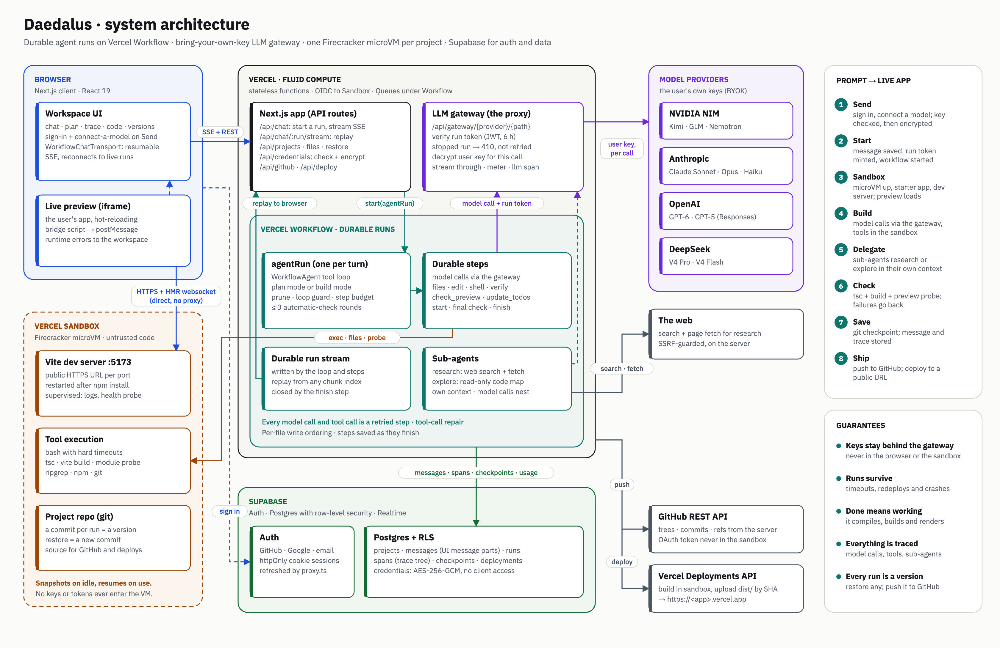

# Daedalus

**Describe an app. Daedalus plans it with you, builds it in a live sandbox, checks its own work, and ships it.**

Daedalus is a vibe-coding platform for both non-technical and technical builders:

- **Plan first.** The agent researches and proposes a plan (features, look and feel, build steps). You approve it with **Start building**, or switch straight to Build.
- **Live preview.** Every project gets its own sandbox microVM running a real dev server. You watch the UI get built, hot-reloading as the agent edits files.
- **It checks its own work.** A build only finishes when the app type-checks, builds and renders. Failures go back to the agent automatically, and you see "Automatic check found 2 problems; Daedalus is fixing them."
- **Your keys, your models.** Bring an Anthropic, OpenAI, DeepSeek or NVIDIA NIM key at sign-up. It's validated and encrypted, and only the Daedalus gateway ever uses it. Switch models at any time; providers without a key show as locked.
- **Customize it.** Connect MCP servers, add skills as `SKILL.md` files, set rules the harness always enforces, keep memories Daedalus proposes, or install a kit that does all of it at once. In the message box, `@` points at a file, `/` uses a skill, and + opens the rest.
- **Sub-agents and a full trace.** The agent delegates research and codebase exploration to sub-agents with their own context. Every model call, tool call and sub-agent is traced, with timings and tokens, in the **Trace** tab.
- **Versions, GitHub and deploys.** Every run is a restorable version (a git commit). Push to a GitHub repo, or deploy to a public URL, from the **Ship** menu.



- **Architecture:** [docs/ARCHITECTURE.md](docs/ARCHITECTURE.md) covers sandboxes, the agent harness, model-agnosticism, the proxy, GitHub, deployment and scaling, and walks through what happens from a prompt to a running app.
- **Customize:** [docs/CUSTOMIZE.md](docs/CUSTOMIZE.md) covers connections (MCP), skills (`SKILL.md`), rules that always run, instructions and approved memory, kits, and suggestions and reviews.
- **Roadmap:** [docs/ROADMAP.md](docs/ROADMAP.md): what's next in the harness and why, from our own code and public sources.

## How it's built

| Piece | Technology |
| --- | --- |
| App, API, LLM gateway | Next.js 16 (App Router) on Vercel, React 19 |
| Durable agent runs | Vercel Workflow + AI SDK v7 `WorkflowAgent`; every model call and tool call is a retried step |
| Sandboxes | Vercel Sandbox (Firecracker microVMs, persistent snapshots) in production; Docker for local dev and CI |
| Auth and data | Supabase: Auth (GitHub, Google, email), Postgres with row-level security, Realtime |
| Models | User keys for Anthropic, OpenAI, DeepSeek, NVIDIA NIM (OpenAI-compatible), behind our gateway |
| Generated apps | Vite 8, React 19, TypeScript, Tailwind CSS v4 starter with a small UI kit (`sandbox-template/`) |

```
src/
  app/                    pages and API routes (chat, gateway, projects, credentials, runs, github, deploy)
  workflows/agent-run.ts  the durable run: start → agent loop → automatic check → finish
  lib/agent/              harness: tools, edit engine, prompts, loop control, repair, sub-agents
  lib/llm/                provider registry, GatewayModel, gateway, run tokens, scripted mock model
  lib/sandbox/            SandboxProvider seam: vercel.ts, docker.ts, provisioning, dev server
  lib/trace/              spans (the trace tree)
  components/             home, sign-in + connect-a-model dialog, workspace (chat, preview, code, trace, plan)
supabase/migrations/      schema with RLS
sandbox-template/         the starter app every project begins from
docker/                   local sandbox image
tests/                    unit (vitest) and end-to-end (Playwright) tests
```

## Run it locally

You need Node 20.9+, pnpm 10, and Docker (for the local Supabase stack and the Docker sandbox).

```bash
pnpm install
pnpm db:start                 # local Supabase in Docker; applies supabase/migrations
pnpm sandbox:image            # builds the local sandbox image (starter app pre-installed)
pnpm search:start             # optional: free, keyless web search (SearXNG) for research sub-agents
cp .env.example .env.local    # then fill in the values (see below)
pnpm dev
```

Open http://localhost:3000, describe an app and press Send. With `NEXT_PUBLIC_ENABLE_MOCK_PROVIDER=1`, the connect-a-model step also offers **Mock (tests)**, a scripted model, so you can try the whole flow without a paid key. To use real models, pick a provider and paste your key.

### Environment

| Variable | What it's for |
| --- | --- |
| `NEXT_PUBLIC_SUPABASE_URL`, `NEXT_PUBLIC_SUPABASE_PUBLISHABLE_KEY`, `SUPABASE_SECRET_KEY` | Supabase project (`supabase status` prints local values) |
| `CREDENTIALS_ENCRYPTION_KEY` | 32 random bytes, base64 (`openssl rand -base64 32`); encrypts model keys and GitHub tokens |
| `GATEWAY_TOKEN_SECRET` | 32+ random characters; signs run tokens for the LLM gateway |
| `GATEWAY_MAX_CALL_MS` | Optional: cap on one streamed model call (default 280000, under the gateway's 300 s function limit) |
| `SANDBOX_PROVIDER` | `docker` locally, `vercel` in production (the default on Vercel) |
| `DOCKER_MAX_SANDBOXES` | Optional, local only: how many project containers may run at once (default 8; the least recently used stops first) |
| `NEXT_PUBLIC_AUTH_PROVIDERS` | Sign-in options to show, e.g. `github,google,email` |
| `NEXT_PUBLIC_ENABLE_MOCK_PROVIDER`, `DAEDALUS_ENABLE_MOCK` | Show and allow the scripted mock model (dev/test only) |
| `GITHUB_CLIENT_ID`, `GITHUB_CLIENT_SECRET` | GitHub OAuth app for "Connect GitHub" (callback `/api/github/callback`) |
| `VERCEL_DEPLOY_TOKEN`, `VERCEL_DEPLOY_TEAM_ID` | Deploying users' apps to Vercel |
| `SEARXNG_URL` | Optional: a SearXNG instance for free, keyless web search (`pnpm search:start` runs one at `http://127.0.0.1:8888`). Tried first |
| `TAVILY_API_KEY`, `BRAVE_SEARCH_API_KEY` | Optional: hosted search APIs, tried next. Tavily's free tier (1,000 searches a month, no card) suits production; Brave is paid. Without any of these, research falls back to DuckDuckGo, then npm and GitHub search |
| `VERCEL_TOKEN`, `VERCEL_TEAM_ID`, `VERCEL_PROJECT_ID` | Vercel Sandbox from a non-Vercel host (on Vercel, OIDC is automatic) |

## Tests

```bash
pnpm typecheck && pnpm lint
pnpm test                                 # unit: edit engine, gateway, repair, loop control, history, parts
node scripts/smoke-api.mjs hello          # API end to end: hello | broken | research | plan
node scripts/smoke-stop.mjs               # stopping a run mid-way
TEST_NVIDIA_API_KEY=… node scripts/smoke-real.mjs "<prompt>" nvidia/nemotron-3-super-120b-a12b
                                          # a real build on NIM; STOP_AFTER_MS=25000 presses Stop mid-run
TEST_NVIDIA_API_KEY=… node scripts/eval-real.mjs nvidia/nemotron-3-super-120b-a12b 3
                                          # golden-task evals: build on a real model, then score the app
node tests/e2e/ui-flow.mjs                # browser: Send → sign up → connect model → plan → build → preview/code/trace
node tests/e2e/rules-audit.mjs            # UI rules audit: contrast, names, labels, targets, headings (desktop/phone, light/dark)
```

The end-to-end tests run the real pipeline (UI, gateway, durable workflow, Docker sandbox, Supabase) against a scripted mock model, so they need no paid keys.

## Deploy

1. Create a Supabase project. Apply the migrations (`supabase link` then `supabase db push`). Enable the GitHub, Google and email providers, with redirect URL `https://<your-domain>/auth/callback`.
2. Create a Vercel project from this repo and set the environment variables above (`SANDBOX_PROVIDER=vercel`).
3. Deploy. Vercel Workflow and Vercel Sandbox need no extra infrastructure; sandbox auth uses OIDC.
