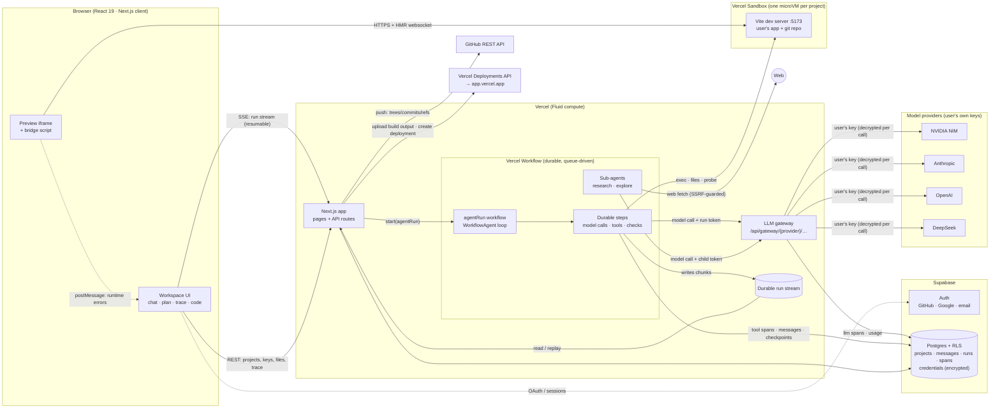
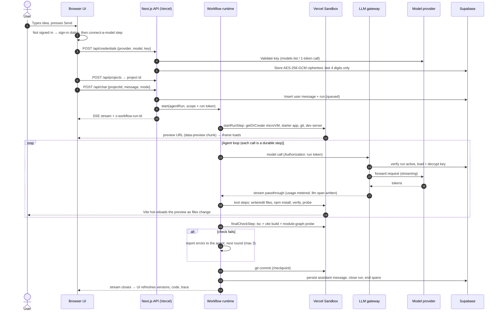

# Daedalus architecture

Daedalus is a vibe-coding platform: you describe an app, an agent plans it with you, builds it in a live sandbox, checks its own work, and ships it. This document explains how it works, why each piece was chosen, and what happens between typing a prompt and seeing the app running live. Everything described as "built" is in this repository and runs today; items marked **next** are designed but not built yet.

**Stack in one line:** Next.js 16 on Vercel (UI, API, LLM gateway), Vercel Workflow for durable agent runs, Vercel Sandbox microVMs for user apps, Supabase for auth, Postgres and realtime, the user's own model keys (Anthropic, OpenAI, DeepSeek, NVIDIA NIM) through our gateway, the GitHub REST API, and the Vercel deployments API.

## Contents

1. [System diagram](#1-system-diagram)
2. [From prompt to live app, step by step](#2-from-prompt-to-live-app-step-by-step)
3. [Sandboxes](#3-sandboxes)
4. [The agent harness](#4-the-agent-harness)
5. [Model-agnostic by design](#5-model-agnostic-by-design)
6. [How the frontend talks to the backend and the sandbox](#6-how-the-frontend-talks-to-the-backend-and-the-sandbox)
7. [Where the proxies sit and what they do](#7-where-the-proxies-sit-and-what-they-do)
8. [GitHub integration](#8-github-integration)
9. [Deployment: user apps and Daedalus itself](#9-deployment-user-apps-and-daedalus-itself)
10. [Scaling to thousands of concurrent builders](#10-scaling-to-thousands-of-concurrent-builders)
11. [Security model](#11-security-model)
12. [Data model](#12-data-model)
13. [Decisions, alternatives and what's next](#13-decisions-alternatives-and-whats-next)

---

## 1. System diagram



A rendered version of this diagram is in [`docs/architecture.svg`](architecture.svg) (also as PNG).

**The four ideas the design rests on:**

1. **A run is a durable workflow, not a request.** Every model call and every tool call is its own retried step. A build survives function timeouts, deploys, crashes and closed tabs, and the browser can reconnect to its stream at any time.
2. **Keys live behind a gateway.** The agent's model client only ever holds a short-lived run token. The gateway swaps it for the user's decrypted key on each call, enforces policy, meters tokens and records the trace.
3. **The sandbox is a seam.** All file, command and preview access goes through one `SandboxHandle` interface. Production uses Vercel Sandbox microVMs; development and CI use Docker. The agent can't tell the difference.
4. **The harness checks its own work.** A build can't finish until the app type-checks, builds and renders. Failures go back to the agent automatically, so "done" means the app actually works.

---

## 2. From prompt to live app, step by step

What happens when someone types "A booking app for a small clinic" on the home page and presses Send (file references are to this repo):



1. **Send opens the gate.** The composer works signed out. Pressing Send saves the idea (it survives an OAuth redirect) and calls `ensureReady()` (`src/lib/client/session.tsx`), which opens the sign-in dialog. After sign-in, the same dialog asks for a provider, a model and the user's API key (`src/components/auth-dialog.tsx`).
2. **The key is checked and locked away.** `POST /api/credentials` validates the key against the provider (a free models-list call, or a 1-token completion for NIM), then stores it encrypted with AES-256-GCM, using the user id as authenticated data so a ciphertext can't be moved between users (`src/lib/crypto.ts`). The browser only ever sees the provider name and last four characters.
3. **A project and a run are created.** The home page creates the project and opens the workspace, which sends the first message. `POST /api/chat` (`src/app/api/chat/route.ts`) checks the user holds a key for the chosen provider, refuses a second concurrent run on the same project, persists the user message, inserts a `runs` row, mints a run token, and starts the durable workflow `agentRun` (`src/workflows/agent-run.ts`). The response is the run's live stream plus an `x-workflow-run-id` header for reconnects.
4. **The sandbox comes up.** The first workflow step (`startRunStep` in `src/lib/agent/run-steps.ts`) calls `ensureProjectSandbox()` (`src/lib/sandbox/index.ts`). That function creates or resumes the project's named microVM, lays down the starter app (Vite 8, React 19, Tailwind 4, TypeScript), installs dependencies, initialises git and starts the dev server. Every stage is idempotent, so a retried step just continues. The preview URL streams to the browser as a `data-preview` chunk and the iframe loads it. The step also reads the file tree, `AGENTS.md` and recent commits into the system prompt.
5. **The agent works.** `WorkflowAgent` runs the loop. Each model call goes through the gateway with the run token. Each tool call (`write_file`, `edit_file`, `run_command`, `verify`, `check_preview`, `research`, …) is a durable step that attaches to the sandbox and records a trace span. Vite hot-reloads the preview as files change, so the user watches the UI being built. Text, reasoning, tool cards, the task list and sub-agent progress all stream into the chat.
6. **The harness checks the work.** When the model says it's done, `finalCheckStep` runs `tsc`, a production build, and a headless probe of every module the browser would load. If anything fails, the report goes back to the agent as a new message and it gets another round (up to three). The user sees "Automatic check found 2 problems; Daedalus is fixing them."
7. **The version is saved.** `finishRunStep` commits the sandbox's git repo (a restorable checkpoint), persists the assistant message, ends the run and its spans, and closes the stream. The UI refreshes the version list, code and trace.
8. **Ship.** From the Ship menu the user can push to GitHub (section 8) or deploy to a public URL (section 9).

---

## 3. Sandboxes

**Choice: Vercel Sandbox** (Firecracker microVMs) behind a `SandboxProvider` interface, with a Docker provider for local development and CI.

### Why Vercel Sandbox

| Need | What Vercel Sandbox gives us |
| --- | --- |
| Real isolation for untrusted, AI-written code | Firecracker microVMs (the same technology as AWS Lambda), not shared-kernel containers |
| Fast, cheap idle projects | **Persistent named sandboxes**: stopping snapshots the filesystem; the next SDK call resumes it. Idle projects cost storage, not compute. |
| Live preview without our own proxy fleet | `sandbox.domain(port)` gives each exposed port a public HTTPS URL (HMR websocket included) |
| Pay for work, not waiting | Billed on **active CPU**: the minutes a VM sits idle while the model thinks aren't charged |
| No credentials to manage on Vercel | OIDC auth is automatic for functions on the same Vercel project |
| Scale | Up to 10,000 concurrent sandboxes on Pro, 45-minute sessions on Hobby and 24 hours on Pro, regional placement, snapshot retention policies |
| Network control | Egress firewall with allow/deny rules and credential-brokering transforms (used in the **next** step for private package registries) |

**Alternatives considered:**

- **E2B:** strong developer experience. It's a separate vendor and billing relationship, and has no persistent-by-default named VMs.
- **Modal:** great for Python and GPU work. Its web preview needs tunnels, and it's an extra platform.
- **Daytona and Fly Machines:** flexible, but we'd build the snapshot and resume lifecycle ourselves.
- **Docker on our own VMs:** cheapest per hour at scale, but containers share a kernel (weaker isolation) and we'd operate the fleet.

Because everything sits behind the interface, swapping the provider is one file.

### The seam

`src/lib/sandbox/types.ts` defines `SandboxHandle` with:

- `exec` (bash with hard timeouts and output caps);
- `spawn` (background processes);
- `readFile` and `writeFiles`;
- `previewUrl(port)`;
- `keepAlive`;
- `stop`.

Every path goes through `resolveInRoot()`, which refuses `../` escapes and absolute paths outside the app.

- `vercel.ts`:
  - `Sandbox.getOrCreate({ name: "dd-<projectId>", ports: [5173], persistent, keepLastSnapshots: 3, snapshotExpiration: 14d })`;
  - commands are wrapped in `timeout -k 5 <s>`;
  - `keepAlive` extends the session while an agent is working.
- `docker.ts`: one long-lived container per project from a local image (`docker/sandbox.Dockerfile`) that has the starter app pre-installed, so projects open instantly. `docker stop`/`start` mirrors persistent sandboxes.

### Lifecycle

1. **Create or resume.** Named sandbox `dd-<projectId>`; the name is enough to reattach from any process or step.
2. **Provision**, idempotently: lay down the starter app, `npm ci`, `git init`, then write the `.daedalus/provisioned` marker. **Next:** a pre-built template snapshot (`VERCEL_TEMPLATE_SNAPSHOT_ID`) skips the install, so a new project is ready in seconds.
3. **Dev server supervision.** `ensureDevServer` probes `localhost:5173`, installs missing dependencies if needed, restarts Vite detached with logs to `/tmp/daedalus-dev.log`, and waits for it to answer. `npm install` from the agent restarts it automatically.
4. **Idle.** The session times out and the VM stops and snapshots. Opening the project later calls `POST /api/projects/:id/preview` to wake it.
5. **Versions.** The app's git repo lives in the sandbox. Each run that changed files becomes a commit (checkpoint). Restoring a version is a new commit, so a restore can itself be undone.

**Security inside the sandbox:** it holds the user's app and nothing else. No model keys, GitHub tokens or Daedalus secrets ever enter it (the gateway and the GitHub push both run outside). Resource limits apply: 2 vCPU, command timeouts, a process limit in Docker. The agent's shell refuses destructive commands (`rm -rf /`, fork bombs, power commands) and `git push`.

---

## 4. The agent harness

The harness lives in `src/lib/agent/` and `src/workflows/agent-run.ts`. It's built on the AI SDK v7 `WorkflowAgent`, which gives us the standard tool loop, made durable.

### The loop

```
agentRun(scope, history)            ── one workflow run per user turn
  startRunStep            sandbox up, context gathered      (durable step)
  repeat up to 3 rounds:
    WorkflowAgent.stream            the model ↔ tool loop
      model call → gateway          (durable step, retries with Retry-After)
      tool calls → steps            (durable steps, run in parallel; same-file writes are ordered)
      prepareStep                   prune old tool output, loop guard, budget note
    finalCheckStep        tsc + vite build + preview probe  (durable step)
    passed? → stop. failed? → append the report as a message → next round
  finishRunStep           git checkpoint, persist message, close run and stream
```

**Why durable.** On Vercel Hobby a function lives at most 5 minutes, and a real build with an open model takes 5–15. Making every model and tool call a separate queued step means no single invocation runs long, the run resumes after a crash or redeploy, transient failures retry automatically, and the browser can drop and reconnect without losing anything. We hit one serialization pitfall: the stock OpenAI-compatible and DeepSeek clients lose their URL builder when serialized between steps. We fixed it with our own `GatewayModel` (section 5).

### Modes

- **Plan first** (read-only): tools are `list_files`, `read_file`, `glob`, `grep`, `research`, `explore` and `propose_plan`. The run ends when the plan is proposed. The UI renders it as a card with **Start building** (`PlanCard`).
- **Build**: the full tool set plus `update_todos`, a task list the agent keeps current; the UI shows it live and in the Plan tab.

Read-only enforcement is double: plan mode only *exposes* read tools (`activeTools`), and the write steps also refuse when `scope.mode === "plan"`.

### Tools

| Tool | What it does | Guard rails |
| --- | --- | --- |
| `list_files`, `glob`, `grep` | Explore the project (ripgrep, with a find/grep fallback) | Skip `node_modules`, `.git`, `dist`; capped output |
| `read_file` | Line-numbered read (`N: …`) with offset/limit | 2,000 lines and 2,000 chars per line; binary detection |
| `write_file` | Create or replace a file; returns a diff | Protected paths (`node_modules`, lockfile, `.git`, `.daedalus`) |
| `edit_file` | Find-and-replace with four matching tiers (below) | Must match exactly once unless `replace_all` |
| `delete_file` | Remove a file or folder | Root and protected paths refused |
| `run_command` | Non-interactive bash in the project | 120 s default, 240 s max; head and tail truncation; blocks dev-server starts, `git push`, destructive commands; restarts Vite after installs |
| `dev_server` | Status, restart, logs | |
| `check_preview` | Crawls Vite's module graph from `index.html` (compile and import errors surface as HTTP 500s) and reads the dev log. If the user has the preview open, it reloads it there and collects the runtime errors and React warnings from that fresh load | No headless browser needed; says so plainly when no browser is watching |
| `verify` | `tsc --noEmit` and `vite build`; parses `file(line,col): error TSxxxx` into structured diagnostics | Exit-code based |
| `update_todos` | The agent's visible task list | |
| `research` | Sub-agent with web search and fetch (plus read access to the project) | Own context; SSRF-guarded fetch; 12-step cap |
| `explore` | Read-only sub-agent that maps a codebase | Own context; 16-step cap |
| `propose_plan` | Plan mode's final answer, rendered as a plan card | Plan mode only |

**Editing.** Models routinely misquote code, so `edit_file` (`src/lib/agent/edit.ts`, unit-tested) tries four tiers in order:

1. **Exact:** an exact match.
2. **Unicode-normalised:** typographic quotes, dashes and spaces folded.
3. **Trailing whitespace ignored:** compared line by line.
4. **Indentation-shifted:** the replacement is re-indented to the file's real indentation.

CRLF files keep their line endings. Tiers 1–3 follow OpenCode's edit tool (MIT); tier 4 is ours. Every edit returns a real line diff (an LCS over the changed region), which the chat shows and the model reads.

### How the agent recovers from errors

Recovery is layered, from cheapest to most drastic:

1. **Tool errors are results, not crashes.** `runTool()` (`src/lib/agent/runtime.ts`) turns an expected failure (a missing file, an `old_string` not found, a non-zero exit code) into `{ ok: false, text: "Error: … what to do instead" }`. The model reads that and adapts.
2. **Infrastructure retries.**
   - A transient sandbox or network error is rethrown on early attempts, so the durable step retries with backoff.
   - Model calls retry on 408, 409, 429 and 5xx and honour `Retry-After`.
   - Side-effecting steps like `run_command` retry at most once.
3. **Tool-call repair** (`src/lib/agent/repair.ts`). Open models often call `bash`, `str_replace` or `TodoWrite` (other harnesses' names), use camelCase keys, or wrap JSON in code fences. We map those to our tools and keys before the call fails. The repair is also schema-aware: it reads the tool's JSON schema to rename a misspelt key to the missing one it resembles, decode arrays and objects sent as JSON strings, and drop stray fields. A real case from Nemotron: `update_todos({"tos": "[{…}]"})` now runs as `update_todos({"todos": [{…}]})` instead of costing a retry.
4. **Doom-loop guard.** If the same tool is called with the same input three steps running, a corrective note is injected: "stop repeating it, re-read the error, try a different approach".
5. **Context management.**
   - Within a run, old tool outputs are replaced with stubs once the prompt passes 55% of the model's window; files can always be re-read.
   - Across runs, earlier turns are compacted to their prose plus an action ledger ("changed src/App.tsx · ran npm install zod · verify passed"); approved plans are kept in full.
6. **Step budget.** 70 steps for build, 24 for plan, with a "wrap up and verify" note four steps before the limit.
7. **The automatic check gate.** It's independent of what the model claims: type-check, build and preview probe must pass, or the failures go back to the agent for up to three rounds.
8. **Stop, even mid-call.**
   - The user's Stop marks the run cancelled.
   - While a model call is streaming, the gateway checks the run every 4 seconds and cuts the upstream call off, ending the stream with an error event in the provider's own format. Any later call gets HTTP 410, which is deliberately not retryable.
   - The loop ends there, the finish step still commits what was done, and the chat shows "Stopped. Changes made so far are kept." Measured with GLM-5.3 on NIM: Stop pressed in the middle of a call, run ended 3.7 seconds later.
9. **Bounded model calls.** Each call is capped at 280 seconds (`GATEWAY_MAX_CALL_MS`), just under the gateway function's 300-second limit. A model stuck reasoning ends with "The model call ran longer than 280 s and was cut off. Try a faster model." instead of a silent platform timeout.
10. **Always finish cleanly.** Any unexpected throw inside the workflow is caught, and the run still persists its message, checkpoints its work, closes its stream and records the error.

Steps are persisted as they complete (`onStepEnd`), so a stopped or failed run shows everything it did.

### Sub-agents and tracing

`research` and `explore` run inside one durable step as an in-process `ToolLoopAgent` with a fresh context window and the provider's fast model (for example gpt-oss-20b on NIM; the Agents tab can change it per project). Only their final summary returns to the main agent, which keeps its context small. Several can run in parallel (tool calls in one step run concurrently).

Every run is traceable (`src/lib/trace/spans.ts`):

- The run is the root span. The sandbox, each tool call and each automatic check are child spans, with deterministic ids so a retried step updates its span instead of duplicating it.
- **Model calls are traced by the gateway**, so they're captured even for sub-agents and regardless of SDK internals. Each one records provider, model, status, time to first byte, input, output, reasoning and cached tokens, and message and tool counts.
- **Sub-agents nest.** A sub-agent gets its own run token whose `spanId` is the sub-agent span. Its model calls land under it in the tree, and its tool calls record child spans too.
- The **Trace** tab renders the tree as a timeline, refreshing while the run is live. Clicking a span shows its inputs, outputs, timing and token counts. Run totals (duration, model calls, tool calls, tokens) sit on top.

### The Agents tab

The workspace's **Agents** tab shows the team working on the project:

- the builder, with its model, runs, model and tool calls, and tokens;
- the research and explore sub-agents, with how often each was called, failures and average duration, all from the trace data;
- the sub-agent model, configurable per project;
- the project's `AGENTS.md`, editable in place and committed to the project's git history;
- the guard rails the harness always applies.

### Prompts and project memory

The system prompt (`src/lib/agent/prompts.ts`) describes the environment (sandbox, the dev server already running, automatic versioning), the workflow (task list, read before you write, verify and check the preview, summarise for a non-technical user), a quality bar (a small visual system, responsive, accessible, realistic content, no `any`), rules against looping, and when to delegate. The project's own `AGENTS.md` is appended, the same convention Codex and Claude Code use, so users and imported repos can steer the agent.

**Good defaults beat long instructions.** The starter app ships a small UI kit in `src/components/ui` (`Page`, `PageHeader`, `Card`, `Button`, `Input`, `Field`, `EmptyState`, `Badge`), with the accent colour defined once in `theme.ts`. Composing from these gives consistent spacing, focus rings and touch targets even from models that only follow part of the quality bar. It's the same idea as the shadcn/ui starters other builders use, at a size an agent can read in one call. The starter also ships `useLocalStorage`, a `useState` that survives reloads, because hand-written load/save effects are the most common way generated apps lose data. Some rules are enforced rather than asked for: the kit's `Button` type requires an `aria-label` when `size="icon"`, so `verify` fails on an unnamed icon button, and the preview bridge flags any unnamed button or link on each load.

### Measuring the harness: golden-task evals

Prompt and harness changes are measured, not eyeballed. `scripts/eval-real.mjs` builds a fixed request on a real model through the whole pipeline. Then `tests/evals/habit-tracker.mjs` uses the generated app the way a person would: add three habits, tick one, check the streak, reload, remove one, reload, then look for console errors and phone layout problems.

Results on Nemotron 3 Super for "Build a habit tracker: add and remove habits, tick a habit off for today, show a streak count per habit, and keep everything in localStorage":

| Harness version | Score | What happened |
| --- | --- | --- |
| Prompt with a visual quality bar | 10/11 | Worked; React warned about a `<circle>` rendered outside an `<svg>` |
| + starter UI kit | 6/10 | Looked better, but the only add form lived in the empty state, and hand-written load/save effects lost data on reload |
| + `useLocalStorage` and a self-review step | 11/11 | Every step passed, on desktop and phone |
| Same, two more runs | 6/11, 6/11 | Tick and delete were icon-only buttons with no name: unusable with a screen reader, and invisible to the test |
| + `aria-label` required by the kit's icon `Button` type, and an accessibility pass in the preview bridge | 11/11, 11/11 | Every step passed in both runs (202 s and 211 s) |

The automatic check passed every one of these builds: type checks, builds and runtime errors can't see a missing feature, and that gap is what the eval covers. **Next:** more tasks (a form-heavy app, a dashboard, an imported repo), several runs per change, and a run on every prompt change in CI.

---

## 5. Model-agnostic by design

**Goal:** switch between Claude, GPT, DeepSeek or open models on NVIDIA NIM without anything else changing. Users bring their own keys.

- **One registry** (`src/lib/llm/providers.ts`) lists each provider's upstream URL, allowed API paths, key format, models, context window, output budget and a `fast` model for sub-agents. The UI and the server read the same file. The model picker shows every provider and **locks** the ones without a key, offering "Add key" inline.
- **One model class.** `GatewayModel` (`src/lib/llm/gateway-model.ts`) implements the AI SDK's `LanguageModelV4` interface.
  - Inside a step, it builds the right client: `@ai-sdk/anthropic`, `@ai-sdk/openai` (Responses API), `@ai-sdk/deepseek`, or `@ai-sdk/openai-compatible` for NIM.
  - That client is always pointed at **our gateway** with the run token as its key.
  - It serializes to four strings (provider, model, gateway URL, token), which is exactly what a durable workflow needs between steps.
- **Provider-neutral history.** Conversations are stored as AI SDK `UIMessage` parts and converted per call, so switching from Nemotron to Claude in the middle of a project just works. Tool schemas are plain JSON Schema (zod), so every provider gets the same tools.
- **Quirk handling lives in the harness, not the product:**
  - tool-call repair for models that drift from the schema;
  - explicit output budgets (some providers default to about 1k tokens, which truncates file writes into broken tool calls);
  - per-model request options in the registry (`requestOptions`, sent as provider options). GLM-5.3 on NIM, for example, gets `reasoning_effort: "low"`: without it, one call reasoned for more than 10 minutes;
  - reasoning tokens shown as a collapsible "Thinking" block when the model emits them.
- **Adding a provider** means adding a registry entry; plus a `case` in `GatewayModel` only if it doesn't speak the OpenAI, Anthropic or DeepSeek dialect. Gemini, for example, works today through Google's OpenAI-compatible endpoint, or natively via `@ai-sdk/google` with one extra case.

### Tested on NVIDIA NIM with a real key

`scripts/probe-nim.mjs` checks each NIM model for chat, streaming and tool calls. `scripts/smoke-real.mjs` runs a whole build through the real pipeline (account, key check, gateway, durable run, sandbox, automatic check) and prints the trace summary.

| Model | Role in Daedalus | Measured |
| --- | --- | --- |
| Nemotron 3 Super (`nvidia/nemotron-3-super-120b-a12b`) | Default builder | Builds the habit tracker from the golden-task evals (section 4) so it passes 11/11, three runs in a row, in 3½–5 minutes with 24–28 model calls, fixing its own type errors along the way |
| GLM-5.3 (`z-ai/glm-5.3`) | Stronger coder, slower | Without limits, one call reasoned for more than 10 minutes. With `reasoning_effort: "low"` from the registry: median call 5.2 s, and Stop pressed mid-call ended the run 3.7 s later |
| gpt-oss-20b (`openai/gpt-oss-20b`) | Sub-agents (fast) | The quickest of the three; 8k output budget |

What the real runs changed in the harness:

- Per-model request options in the registry, a per-call time cap and Stop that cuts a call mid-stream (sections 4 and 7).
- Not every NIM account can reach every model: Kimi K2.6 answers 404 "Not found for account" for some keys. The key check pings the chosen model, so the user hears about it at sign-up, not mid-build.
- Free-tier models can be busy. The key check then validates the key against a lighter model and shows a warning, instead of rejecting a working key.
- Schema-aware tool-call repair, from a real Nemotron call (section 4).
- The starter UI kit, after the first real build came out plain (section 4, "Prompts and project memory").

---

## 6. How the frontend talks to the backend and the sandbox

| Channel | Transport | Used for |
| --- | --- | --- |
| Run stream | `POST /api/chat` → Server-Sent Events of AI SDK UI message chunks; reconnect with `GET /api/chat/{workflowRunId}/stream?startIndex=n` | Live text, reasoning, tool calls and results, `data-*` parts (sandbox status, preview URL, sub-agent progress, checks, checkpoint) |
| REST | `/api/projects`, `/api/credentials`, `/api/runs/:id/spans`, `/api/projects/:id/files`, `…/file`, `…/restore`, `…/preview`, `…/github`, `…/deploy` | Everything else; all authorized with the Supabase session (cookie, or bearer token for API clients and tests) |
| Preview | The browser loads `https://<sandbox-domain>` in an iframe; Vite's HMR websocket connects directly to the sandbox | The live app, hot-reloading as the agent edits |
| Preview → workspace | A bridge script in the app (injected by a dev-only Vite plugin) `postMessage`s runtime errors and navigation to the parent; the workspace checks the origin, shows the error with "Ask Daedalus to fix it", and forwards it to `/api/projects/:id/preview-errors`, where the agent's `check_preview` reads it. When a check runs, the workspace reloads the preview and tags what that load reports with the check's id, so the check reads exactly the errors from the current code (React warns once per page load, and request order doesn't match event order) | Closing the loop on errors only a real browser sees |
| Workspace → preview | The workspace `postMessage`s `select-mode` into the iframe; the bridge outlines elements under the cursor and, on click, describes the element (tag, text, a short CSS path) back. The composer is pre-filled with "Change the button "Book now" (at main > section.hero > …): " | Select-to-edit: point at the thing you want changed |

**Resumable streaming.** The run writes to a durable stream owned by the workflow. `WorkflowChatTransport` replays from the last chunk index after a dropped connection, and the workspace reconnects to an in-flight run on page load. Our UI transform (`src/lib/agent/ui-transform.ts`) keeps the `data-*` parts that the stock transform drops, and pins the assistant message id so the live message and the saved one are the same message. Tool inputs stream too: while the model is still writing a file, its card shows the code arriving, line by line.

**Persistence.** The source of truth for the chat is `messages` in Postgres. User messages are written when sent; the assistant message is built from the steps in the order they ran, with the automatic-check results in place, and written by the finish step.

---

## 7. Where the proxies sit and what they do

### The LLM gateway (built)

It sits between every agent model call and every provider, at `/api/gateway/{provider}/{path}` (`src/lib/llm/gateway.ts`, `gateway-hooks.ts`).

```
GatewayModel (in a workflow step) ──Authorization: <run token>──▶ Gateway ──<user's key>──▶ Provider
```

For each call it:

1. **Authenticates the run token**: an HS256 JWT carrying user, run, project, provider and parent span, valid 6 hours. A token for one provider can't be used against another.
2. **Applies policy.** The run must exist, belong to the user and still be active (a stopped run gets 410). Paths are allowlisted per provider (`chat/completions`, `messages`, `responses`, `models`), which also blocks SSRF through the gateway. Budgets and rate limits are applied here (**next**).
3. **Custodies keys.** It loads the user's credential, decrypts it in memory for this request only, and sends it as `Authorization` or `x-api-key`. A 401 from the provider marks the key invalid so the UI can ask for a new one.
4. **Forwards with streaming intact, and bounds every call.** Bytes are passed through untouched while SSE events are sniffed for usage. Provider errors and `Retry-After` pass through, so SDK retries behave normally. One abort controller covers the upstream call: the client going away, the user's Stop (polled every 4 s while streaming) or the 280 s cap all cut it off, and the stream ends with an error event the SDK surfaces like any provider error.
5. **Meters and traces.** It records an `llm` span (time to first byte, duration, token counts, status) and increments the run's usage counters. A call cut off by Stop is traced as `cancelled`, not as an error; calls refused after Stop never reached the model and aren't recorded.

**Why a gateway instead of decrypting the key in the workflow:**

- Keys never enter the durable event log, step payloads or the sandbox.
- There's one place for metering, budgets, kill switches and tracing.
- It's provider-agnostic.
- It's the same path for the main agent and its sub-agents.

### The preview path (built: direct; next: preview proxy)

Today the iframe loads the sandbox's public URL directly. That gives the lowest latency, HMR works natively, and there are no proxy servers to run. The planned production preview proxy at `*.preview.daedalus.app` adds:

- an auth cookie, so private apps stay private;
- wake-on-request for stopped sandboxes, with a branded "waking your app" page;
- per-project rate limits;
- the error bridge injected at the edge rather than in `vite.config.ts`.

It would run as a Vercel route or Cloudflare Worker that resolves `project → sandbox domain`.

---

## 8. GitHub integration

Built in `src/lib/github.ts` and `src/app/api/github/*`.

- **Connect:** an OAuth App with `repo` scope and a CSRF `state` cookie. The token is encrypted exactly like model keys.
- **Push** ("Create repo and push" / "Push changes"):
  1. On first push, create a private repo named after the project (`auto_init`, because the Git Data API can't write to an empty repo).
  2. Read the sandbox's committed files (`git ls-files`).
  3. Create a tree (text inline, binaries as blobs).
  4. Create a commit on the current head with the latest checkpoint's message, then fast-forward the branch.

  All of this runs from the server: **the token never enters the sandbox**, and no credentials live in the user's repo.
- **Import (next):** paste a repo URL → download the tarball with the user's token → write into a new project's sandbox → the `explore` sub-agent maps it → `AGENTS.md` and `CLAUDE.md` in the repo steer the agent.
- **Next:**
  - a GitHub App with fine-grained per-repo permissions;
  - webhooks for two-way sync (pull outside commits into the sandbox before the next run);
  - a branch and pull request per run, for teams that review.

---

## 9. Deployment: user apps and Daedalus itself

### User apps (built: `src/lib/deploy.ts`)

1. Build in the sandbox: `npm run build` → `dist/`. A failed build is shown with its log.
2. Upload each output file to Vercel by SHA-1 (`/v2/files`); unchanged files are deduplicated by Vercel across deploys.
3. Create a production deployment (`/v13/deployments`) of a per-project Vercel project under the Daedalus team, with an SPA rewrite.
4. Poll until `READY` and save the URL (`https://<app>-<id>.vercel.app`) on the project; the Ship menu shows it.

Deployments are static by default, which suits the frontend apps the agent builds. **Next:** custom domains, and serverless functions for full-stack apps (the deploy is source-based instead of `dist`-based).

### Daedalus itself

- **Vercel** hosts the Next.js app on Fluid compute. Workflow runs on Vercel Queues automatically. Sandbox access uses OIDC with no stored token. A step may run up to 300 s on Hobby and 800 s on Pro; a run can last hours.
- **Supabase** provides Auth (GitHub, Google, email), Postgres with row-level security on every table, and Realtime for runs and spans. Migrations live in `supabase/migrations/`.
- **Configuration:** environment variables on Vercel. Secrets: Supabase service key, credential encryption key, gateway token secret, GitHub OAuth, and a Vercel deploy token for user apps.
- **CI:** typecheck, lint, unit tests (vitest) and end-to-end tests. The e2e tests drive the real UI against local Supabase, a Docker sandbox and a scripted mock model, so the whole pipeline is testable without paid keys.
- **Portability:** the Workflow SDK also runs on a Postgres "world", and the sandbox seam has a Docker provider. Daedalus can be self-hosted off Vercel.

---

## 10. Scaling to thousands of concurrent builders

| Layer | How it scales | Limits and levers |
| --- | --- | --- |
| Web and API | Stateless Next.js functions on Fluid compute, autoscaled | |
| Agent runs | Every model and tool call is a short queued step, so thousands of runs don't pin thousands of long-lived servers. Bursts queue instead of failing. | Event and step limits per run (25k / 10k); per-user concurrent-run caps; one active run per project (enforced) |
| Sandboxes | One microVM per *active* project. Idle projects stop and snapshot, so compute tracks concurrent builders, not total users. | 10,000 concurrent on Pro, regional placement; a template snapshot makes cold start seconds; per-plan quotas |
| Models | BYOK: provider rate limits are per *user*, not one platform-wide bottleneck. The gateway is stateless. | Per-user budgets and rate limits at the gateway; fast models for sub-agents |
| Database | Supabase Postgres behind the Supavisor pooler; narrow indexed queries (`project_id, created_at`) | Spans are the hot table: partition by month, keep 30 days, archive. Messages are paginated. Realtime only for active runs. |
| Streams | Durable streams decouple producers and readers; reconnects replay from an index. | Retention: 1 day on Hobby, 7 on Pro. The chat's durable copy lives in Postgres. |
| Cost | A typical build is about 30–60 model calls (paid by the user's key), roughly 1–3 active-CPU minutes of sandbox (the VM idles while the model thinks), and a few hundred workflow events. | Idle timeouts, snapshot retention (`keepLastSnapshots: 3`), build quotas per plan |

**Failure isolation:**

- One user's runaway build can't starve others: the queue is fair, step and token budgets apply, and the sandbox is the user's own.
- A provider outage only affects that provider's users, who can switch models in one click.
- A redeploy of Daedalus doesn't kill in-flight builds; they resume on the new version.

---

## 11. Security model

- **Secrets.** Model keys and GitHub tokens are encrypted at rest (AES-256-GCM with per-user authenticated data) with a key held in the environment (a KMS in production). They're decrypted only inside the gateway or the GitHub push, for one request. They never reach the browser, the sandbox or the workflow event log. The `credentials` and `github_connections` tables have RLS with no policies and revoked grants, so only the service role can read them.
- **Tenancy.** Every table carries `user_id`. RLS lets a user read only their own rows; server code uses the service role and always filters by `user_id` explicitly.
- **Run tokens.** Short-lived, scoped to one run, one provider and one span, and useless anywhere except our gateway. A stopped or finished run's token is refused.
- **Sandboxes.** MicroVM isolation; no platform secrets inside; command timeouts and resource limits; destructive commands refused; preview errors accepted only from the sandbox's own origin.
- **Web access.** Research fetches run on the server with SSRF guards: http(s) only, DNS resolution and re-checks on every redirect against private ranges, plus size and time limits. Fetched content goes to an isolated sub-agent, and only its summary reaches the main agent, which limits prompt-injection blast radius.
- **Auth.** Supabase sessions in httpOnly cookies, refreshed by `proxy.ts`; OAuth `state` checks for the GitHub flow.

---

## 12. Data model

```mermaid
erDiagram
  profiles ||--o{ projects : owns
  profiles ||--o{ credentials : "holds keys (encrypted)"
  profiles ||--o| github_connections : "connects"
  projects ||--o{ messages : "conversation"
  projects ||--o{ runs : "agent turns"
  runs ||--o{ spans : "trace tree"
  projects ||--o{ checkpoints : "versions (git commits)"
  projects ||--o{ deployments : "ships"
  projects ||--o{ preview_errors : "browser errors"

  profiles { uuid id PK; text active_provider; text active_model }
  credentials { uuid id PK; uuid user_id; text provider; text key_ciphertext; text key_last4; text default_model; text status }
  projects { uuid id PK; uuid user_id; text name; text sandbox_id; text preview_url; text github_repo; text deploy_url }
  messages { text id PK; uuid project_id; text role; jsonb parts; uuid run_id }
  runs { uuid id PK; uuid project_id; text workflow_run_id; text mode; text provider; text model; text status; bigint input_tokens; bigint output_tokens }
  spans { uuid id PK; uuid run_id; uuid parent_id; text kind; text name; text status; int duration_ms; jsonb attrs }
  checkpoints { uuid id PK; uuid project_id; text sha; text message }
  deployments { uuid id PK; uuid project_id; text url; text status }
```

---

## 13. Decisions, alternatives and what's next

| Decision | Chosen | Over | Because |
| --- | --- | --- | --- |
| Run execution | Vercel Workflow (`WorkflowAgent`) | One long request; our own job queue | Survives the 5-minute limit, retries per step, resumable streams, no queue to operate |
| Sandbox | Vercel Sandbox + Docker for dev | E2B, Modal, Daytona, own VMs | MicroVM isolation, persistent snapshots, built-in preview URLs, OIDC, active-CPU billing |
| Keys | BYOK through a gateway | Platform keys; decrypting in the workflow | Users control cost and model; keys never leave one request |
| Harness | Our own on AI SDK v7 | Wrapping Claude Code or Codex (`HarnessAgent`) | Model-agnostic BYOK across four providers, our own tools, checks and tracing |
| Generated stack | Vite + React + TypeScript + Tailwind v4 | Next.js apps | Instant HMR, static deploys, small surface for open models |
| Versions | git inside the sandbox | Snapshots only | Cheap, diffable, restorable, and pushes straight to GitHub |
| Tracing | Spans in Postgres, model calls recorded at the gateway | Only OpenTelemetry | Visible to the user in-product; nested sub-agents; OTel export can be added on top |

**Next, in order:**

1. GitHub import (tarball → sandbox → `explore`).
2. Template snapshot for instant cold starts.
3. Gateway budgets and rate limits.
4. The preview proxy (private previews, wake on request).
5. More project types: a Node AI-SDK agent template and a Python FastAPI/LangGraph agent template ("build agents in any framework").
6. A GitHub App with PR-per-run.
7. Full-stack deploys with Supabase provisioning per app.
